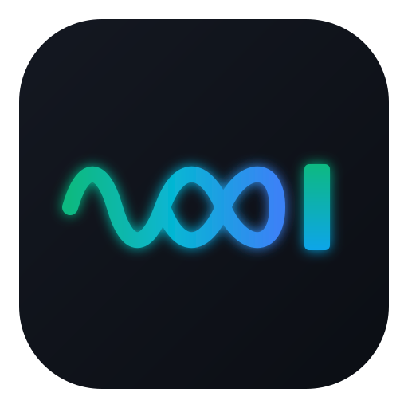

<div align="center">
  <!-- 你的专属呼吸闪烁 SVG 图标 -->
  

  <!-- 动态极客打字机签名 -->
  <p>
    
  </p>

  <!-- 核心标签徽章 -->
  <p>
    
    
    
  </p>
</div>

---

### 🧠 About Me | 探索者画像

```yaml
Role: 独立数学竞赛教练 / AI 编程折腾者
Philosophy: 远离复杂人情世故，用纯粹的数学逻辑与代码对话
Learning_Style: 边学边忘，持续迭代，永远对新事物保持好奇
Current_Quest: 用数学建模思维驾驭 AI 编程，打造有趣且实用的小工具
```

### 🛠️ Tech & Exploration Stack | 折腾工具箱

<div align="left">
  
  
  
  
  
</div>

<br />

### 📊 GitHub Telemetry | 代码折腾轨迹

<div align="center">
  <!-- 实时 GitHub 统计卡片（已自动绑定你的用户名 tsongj） -->
  
  
</div>

<br />

<div align="center">
  <sub><i>"遗忘的是表层语法，沉淀下来的是思维直觉与探索的勇气。"</i></sub>
</div>
